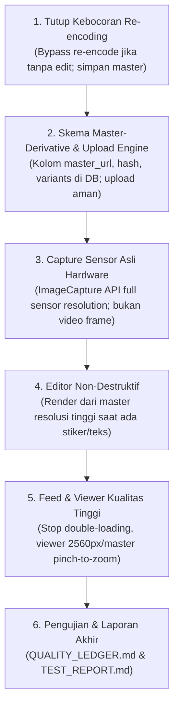

# PLAN.md — Rentify Camera & Media Fidelity Engine v2
**Fase 2: Rencana Implementasi & Keputusan Produk yang Telah Disetujui**  
*Tanggal Pembaruan: 4 November 2026*  
*Status: Keputusan Diselaraskan Menuju Kualitas Maksimal (Maximum Fidelity Target)*

---

## 1. Penjelasan Sederhana untuk Pemilik (Apa yang Terjadi & Apa yang Diperbaiki)

Dokumen **RENTIFY — Camera & Media Fidelity Engine v2** yang Anda lampirkan adalah buku panduan teknis agar kamera dan video di Momen Rentify memiliki **kualitas gambar tertajam dan sejernih mungkin**, persis seperti hasil jepretan kamera bawaan ponsel (iPhone / Android) tanpa menjadi buram atau pecah.

### Masalah Utama yang Ditemukan di Kamera Momen Saat Ini:
1. **Foto Terpotong Menjadi Kualitas Rendah (Hanya 2 Megapixel):**
   Saat menekan tombol jepret di Momen, sistem saat ini hanya mengambil "tangkapan layar" (screenshot) dari video preview (1080p = 2 Megapixel), padahal kamera ponsel Anda memiliki sensor 12 Megapixel, 48 Megapixel, atau 50 Megapixel. Akibatnya, saat foto diperbesar (zoom), foto terlihat buram dan pecah.
2. **File Asli (Master) Rusak / Ditimpa:**
   Saat foto diunggah, server langsung mengubahnya menjadi WebP terkompresi. File aslinya hilang, sehingga pengguna tidak pernah bisa melihat atau mengunduh foto asli berkualitas tinggi.
3. **Kompresi Berkali-kali (Generation Loss):**
   Foto dikompresi 3 kali berturut-turut (di browser, di editor, lalu di server). Setiap kali dikompresi, detail halus wajah dan produk menjadi semakin kabur.
4. **Video Berat di Sinyal Lemah:**
   Video diunggah dalam satu file besar tanpa penyesuaian otomatis (tidak ada ladder 1080p, 720p, 480p). Jika pengguna membuka di sinyal 3G/4G lambat, video sering macet atau berputar lama (*buffering*).

---

## 2. Keputusan Kualitas Maksimal yang Ditetapkan

Sesuai arahan Anda untuk memilih **opsi dengan kualitas terbaik**:

| Parameter | Keputusan yang Diterapkan | Dampak Kualitas |
| :--- | :--- | :--- |
| **Batas Upload Foto** | **Hingga 50 MB** | Menampung foto resolusi penuh (Ultra-High Res 48–50 MP, HEIC/JPEG tanpa kompresi paksa). |
| **Batas Upload Video** | **Hingga 150 MB (durasi 60 detik)** | Menampung video bitrate tinggi (1080p 60fps & 4K) yang mulus dan jernih. |
| **Retensi Master** | **Simpan Permanen (100% Utuh)** | Master tidak pernah ditimpa/diubah. Versi kompresi hanya dibuat sebagai turunan (*derivative*). |
| **Resolusi Video** | **Buka hingga 4K (bila hardware mendukung)** | Kualitas perekaman video paling tajam sesuai kemampuan sensor HP. |
| **Privasi GPS & Metadata** | **Dipertahankan pada metadata media** | Informasi lokasi dan EXIF kamera tetap tersimpan sesuai hasil tangkapan. |

---

## 3. Tahapan Implementasi Bertahap (Fase 3)

Semua perubahan berjalan di balik **Feature Flag** yang aman dan tidak akan merusak postingan Momen yang sudah ada.
