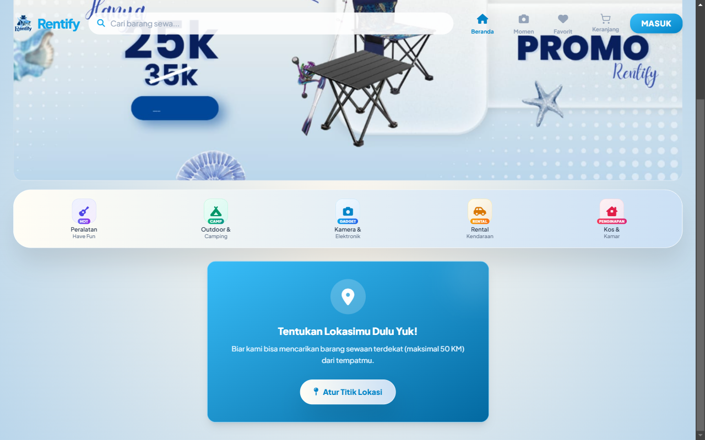
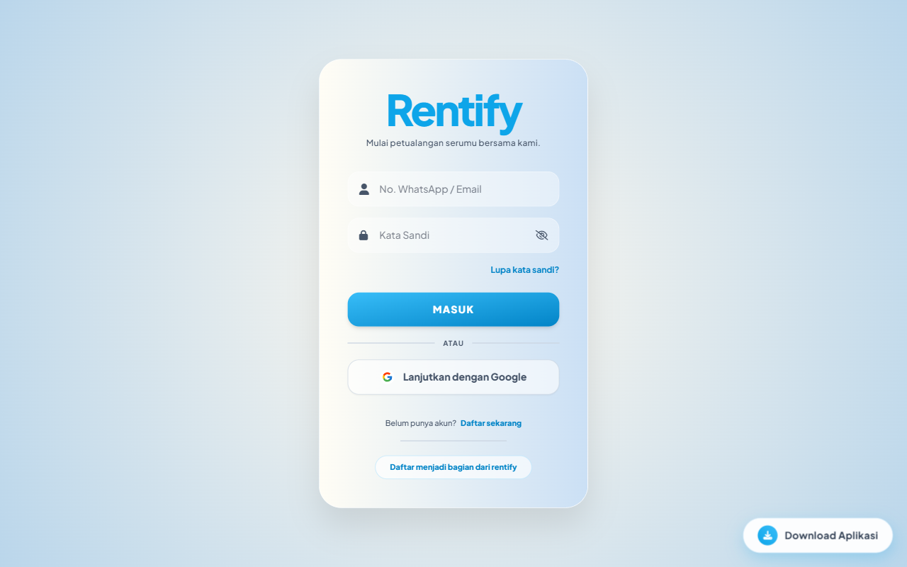
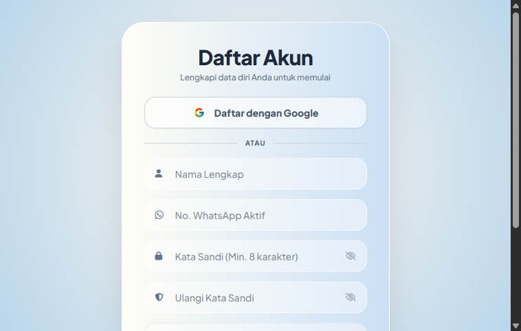
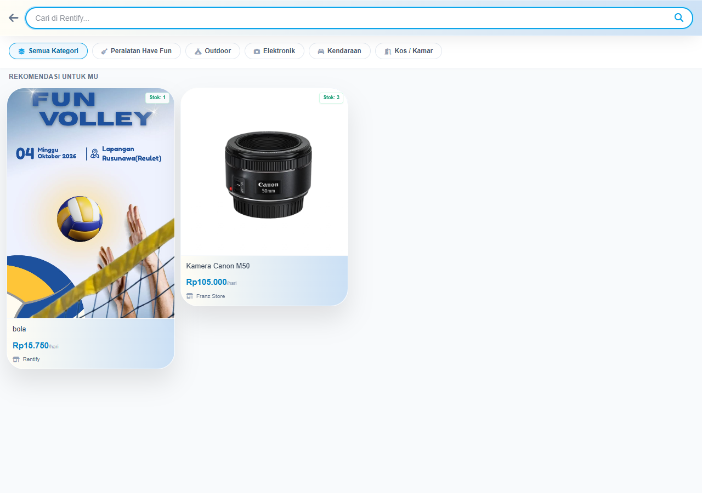
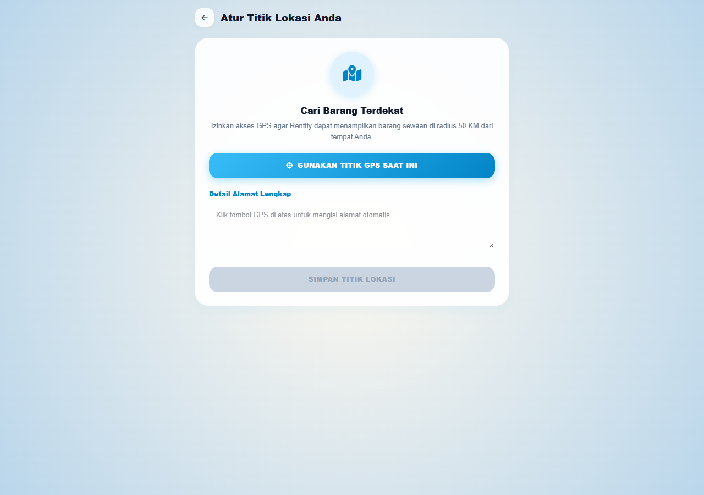
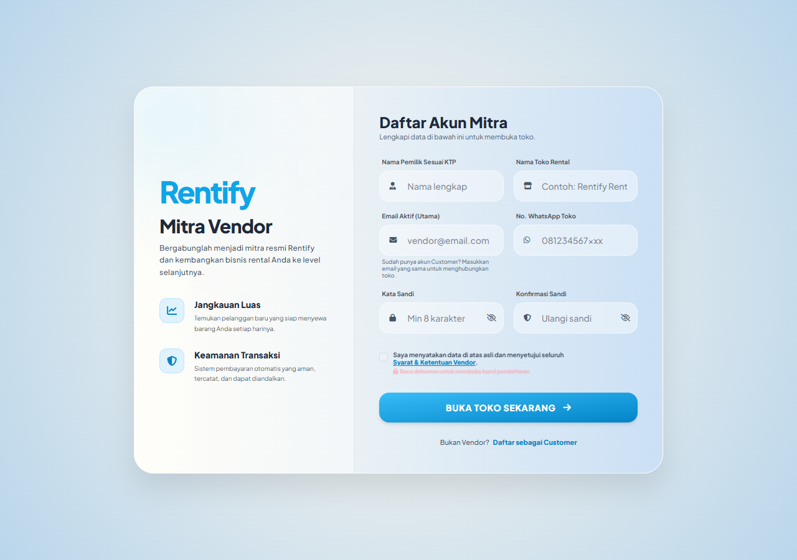

# 🚀 Rentify — Platform Marketplace Sewa Terintegrasi

<p align="center">
  
</p>

<p align="center">
  <strong>Solusi Cerdas Penyewaan Barang Multi-Vendor dengan Dynamic QRIS, Microservice WhatsApp Gateway, dan Moments Social Commerce.</strong>
</p>

<p align="center">
  <a href="https://rentify21.my.id" target="_blank"></a>
  <a href="https://github.com/Joni21-hub/Rentify" target="_blank"></a>
</p>

<p align="center">
  
  
  
  
  
  
</p>

---

## 📌 Ringkasan Proyek

**Rentify** adalah platform *e-commerce rental* (marketplace sewa barang) yang menghubungkan penyewa (*Customer*) dengan pemilik rental (*Vendor*) di bawah pengawasan terpusat (*Admin*). Sistem ini dirancang untuk menyelesaikan persoalan operasional rental konvensional dengan menghadirkan:

1. **Keamanan Transaksi Terpadu**: Pembayaran berbasis **Dynamic QRIS (Standar ASPI/Bank Indonesia)** dan pencocokan otomatis mutasi rekening.
2. **Notifikasi Instan 24/7**: Microservice **WhatsApp Gateway (Node.js & Baileys)** untuk pengiriman invoice, bukti booking, status pesanan, dan asisten virtual.
3. **Moments Social Commerce**: Feed video pendek interaktif (gaya reels/TikTok) yang memfasilitasi *product tagging*, *like*, *comment*, dan sistem *coin cashback reward*.
4. **Pencarian Berbasis Lokasi (Haversine Formula)**: Membantu pelanggan menemukan barang rental terdekat secara akurat.

---

## 🌐 Informasi Live Demo & Pengujian

Aplikasi telah terpasang dan berjalan langsung pada infrastruktur *cloud*:

- **URL Aplikasi**: [https://rentify21.my.id](https://rentify21.my.id)
- **Repositori GitHub**: [https://github.com/Joni21-hub/Rentify](https://github.com/Joni21-hub/Rentify)

### 🔑 Akun Demo (Credentials)

Untuk keperluan pengujian fitur oleh dosen/evaluator, telah disiapkan akun untuk ketiga role utama:

| Role | Email Login | Password | Keterangan Akses |
|---|---|---|---|
| **Super Admin** | `rentify.id@gmail.com` | `Rentify21` | Akses penuh dashboard admin, moderasi vendor, kelola pembayaran & mutasi, validasi pencairan dana, monitoring WhatsApp Gateway, dan laporan keuangan. |
| **Vendor (Toko Rental)** | `vendor@rentify.com` | `password123` | Akses dashboard vendor, kelola katalog produk, stok & harga harian, proses pesanan masuk, pantau saldo aktif, dan penarikan dana. |
| **Customer (Penyewa)** | `customer@rentify.com` | `password123` | Akses katalog rental, filter radius terdekat, checkout QRIS, tracking pesanan real-time, beri ulasan bintang, dan kumpulkan Rentify Coins di Moments. |

---

## 📸 Galeri Tampilan Antarmuka (Screenshots)

Berikut adalah beberapa tangkapan layar antarmuka sistem Rentify:

| Beranda Pelanggan & Katalog Unggulan | Halaman Autentikasi / Login Multi-Role |
|:---:|:---:|
|  |  |
| *Tampilan beranda responsif dengan rekomendasi kategori dan barang.* | *Autentikasi aman terintegrasi dengan proteksi brute-force.* |

| Registrasi Pengguna Baru | Pencarian Barang & Filter Kategori |
|:---:|:---:|
|  |  |
| *Pendaftaran customer dengan validasi OTP dan email verifikasi.* | *Pencarian cepat dengan filter harga, kategori, dan ketersediaan.* |

| Filter Berbasis Lokasi & Radius Terdekat | Pendaftaran Vendor (Buka Toko Sewa) |
|:---:|:---:|
|  |  |
| *Kalkulasi jarak Haversine untuk menemukan vendor terdekat.* | *Formulir pendaftaran mitra toko sewa dengan verifikasi data.* |

---

## ✨ Fitur-Fitur Utama

### 1. 🛡️ Multi-Role & Hak Akses (RBAC)
- **Super Admin**: Mengontrol ekosistem marketplace, memvalidasi toko baru, memantau mutasi rekening masuk, menyetujui penarikan saldo vendor, serta mengekspor laporan transaksi dalam format PDF & Excel.
- **Vendor**: Manajemen produk sewa (foto galeri, deskripsi, stok harian, tarif harian/mingguan), manajemen pesanan masuk (*Menunggu Konfirmasi*, *Disetujui*, *Sedang Disewa*, *Selesai*), pelacakan saldo aktif, serta penarikan dana ke rekening bank.
- **Customer**: Eksplorasi katalog, filter barang berdasarkan lokasi koordinat GPS, *booking calendar*, keranjang sewa, pembayaran QRIS, konfirmasi pembayaran, pelacakan status pesanan bergaya *e-commerce timeline*, dan pengisian ulasan bintang.

### 2. 💳 Dynamic QRIS & Transaksi Aman
- Pembuatan string QRIS dinamis berstandar nasional (ASPI/NMID Bank Indonesia).
- Sistem pelindung *anti-tampering* transaksi serta verifikasi struk pembayaran.
- Layanan *TransactionCalculationService* dan *CoinAccountingService* untuk memastikan pencatatan keuangan akurat dan bebas dari anomali pembukuan.

### 3. 📱 Microservice WhatsApp Gateway (Self-Hosted Baileys)
- Terletak pada direktori `whatsapp-gateway/`.
- Beroperasi secara independen menggunakan Node.js dan pustaka `@whiskeysockets/baileys`.
- Mengirimkan pesan notifikasi transaksi langsung ke nomor WhatsApp pelanggan dan vendor (tagihan invoice, konfirmasi pesanan disetujui, dan pengingat pengembalian barang).
- Dilengkapi asisten virtual otomatis untuk merespons pertanyaan pelanggan.

### 4. 🎬 Moments — Social Commerce & Coin Cashback
- Fitur eksplorasi konten video sewa (Shopee Video / Instagram Reels look-and-feel).
- Dukungan interaksi: *Like*, *Comment*, *Bookmark*, dan *Product Tagging* (klik produk langsung mengarah ke halaman sewa).
- Insentif interaksi berupa koin reward (*Rentify Coins*) yang dapat dipotongkan sebagai diskon belanja saat *checkout*.

---

## 🛠️ Arsitektur & Teknologi

```
Rentify/
├── app/                        # Logika Inti Laravel 11 (MVC)
│   ├── Http/Controllers/      # Controller Admin, Vendor, Customer, & API
│   ├── Models/                # Eloquent Models (User, Barang, Penyewaan, Moment, dll.)
│   └── Services/              # Business Logic (Transaction, WhatsApp, Mutasi, Coins)
├── database/                   # Migrasi Skema & Seeder
│   ├── migrations/            # Migration berkas tabel lengkap
│   ├── seeders/               # DatabaseSeeder (Akun demo & kategori bawaan)
│   └── rentify.sql            # SQL dump bersih siap import langsung
├── docs/                       # Dokumentasi & Screenshot
│   └── screenshots/           # Aset visual antarmuka sistem
├── public/                     # Aset publik, CSS tema Rentify, dan favicon
├── resources/views/            # Template Blade UI (Admin, Vendor, Customer, Moments)
├── routes/                     # Definisi rute aplikasi (web.php, console.php)
└── whatsapp-gateway/           # Microservice Node.js Baileys WhatsApp Gateway
```

- **Backend**: PHP 8.2+ / Laravel 11.x
- **Frontend**: Blade Templating Engine, Tailwind CSS, Alpine.js
- **Basis Data**: MySQL 8.0 (InnoDb dengan Relasi Foreign Key & Indeks)
- **Microservice**: Node.js v18+, Express, Baileys WebSocket WhatsApp Client
- **Dokumentasi PDF**: DomPDF untuk cetak invoice dan laporan bulanan

---

## 💻 Panduan Instalasi Lokal (Development Setup)

Ikuti langkah-langkah berikut untuk menjalankan proyek di komputer lokal (misal: Windows dengan XAMPP):

### 1. Prasyarat Sistem
- **PHP** >= 8.2 (ekstensi `pdo_mysql`, `mbstring`, `fileinfo`, `gd`, `curl`, `openssl` aktif)
- **Composer** 2.x
- **MySQL / MariaDB** (via XAMPP atau standalone)
- **Node.js** >= 18.x & NPM
- **Git**

### 2. Kloning Repositori
```bash
git clone https://github.com/Joni21-hub/Rentify.git
cd Rentify
```

### 3. Instal Dependensi PHP & Node
```bash
# Instal paket dependensi Laravel
composer install

# Instal dependensi frontend
npm install
npm run build
```

### 4. Konfigurasi Environment (`.env`)
Salin berkas konfigurasi template:
```bash
cp .env.example .env
php artisan key:generate
```

Sesuaikan konfigurasi basis data pada `.env`:
```env
DB_CONNECTION=mysql
DB_HOST=127.0.0.1
DB_PORT=3306
DB_DATABASE=rentify
DB_USERNAME=root
DB_PASSWORD=
```

### 5. Setup Basis Data

Pilih salah satu dari 2 metode berikut:

**Metode A: Melalui Migration & Seeder Laravel (Direkomendasikan)**
```bash
php artisan migrate --seed
```

**Metode B: Melalui Import SQL Langsung ke phpMyAdmin / MySQL CLI**
1. Buat database baru bernama `rentify`.
2. Import berkas `database/rentify.sql` (atau `rentify_backup.sql`) ke dalam database tersebut.

### 6. Jalankan Storage Link
```bash
php artisan storage:link
```

### 7. Jalankan Server Aplikasi
```bash
php artisan serve
```
Buka browser dan akses aplikasi melalui: `http://localhost:8000`

---

## 📲 Panduan Menjalankan WhatsApp Gateway (Opsional)

Jika ingin menjalankan bot dan notifikasi WhatsApp lokal:

```bash
cd whatsapp-gateway
npm install
node server.js
```
Akses `http://localhost:3000` untuk memindai kode QR WhatsApp session.

---

## 🧪 Pengujian Sistem (Automated Testing)

Proyek ini telah dilengkapi dengan puluhan berkas *feature test* dan *unit test* menggunakan PHPUnit:

```bash
./vendor/bin/phpunit
```

Pengujian mencakup:
- `MultiRoleAuthTest`: Validasi hak akses Admin, Vendor, dan Customer.
- `CustomerRentalTransactionTest`: Siklus pemesanan, invoice, dan pelunasan.
- `MomentFeedAndRankingTest`: Algoritma feed video pendek dan moderasi konten.
- `CoinAccountingServiceTest`: Integritas pembukuan koin dan proteksi saldo minus.

---

## 📄 Berkas Pengumpulan Tugas

Untuk keperluan pengumpulan tugas / proyek akhir, berikut komponen yang disiapkan:

1. **Kode Sumber Bersih**: Tersedia di GitHub `main` branch.
2. **Database SQL Dump**: Berkas `database/rentify.sql` dan seeder `database/seeders/DatabaseSeeder.php`.
3. **Dokumentasi & Bukti Visual**: Berkas gambar di folder `docs/screenshots/`.
4. **Link Produksi**: [https://rentify21.my.id](https://rentify21.my.id)

---

## 👥 Pengembang & Hak Cipta

- **Pengembang**: Tim Proyek Rentify ([Joni21-hub](https://github.com/Joni21-hub))
- **Lisensi**: Proyek ini dilisensikan di bawah [MIT License](LICENSE).
